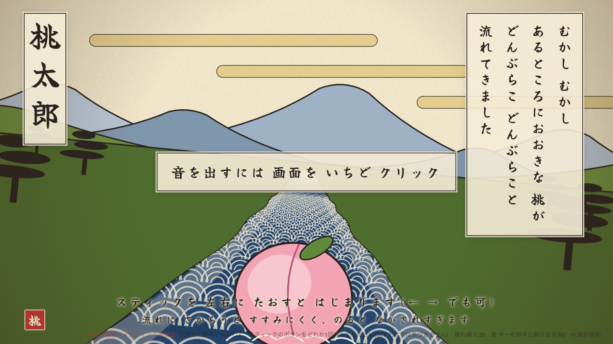
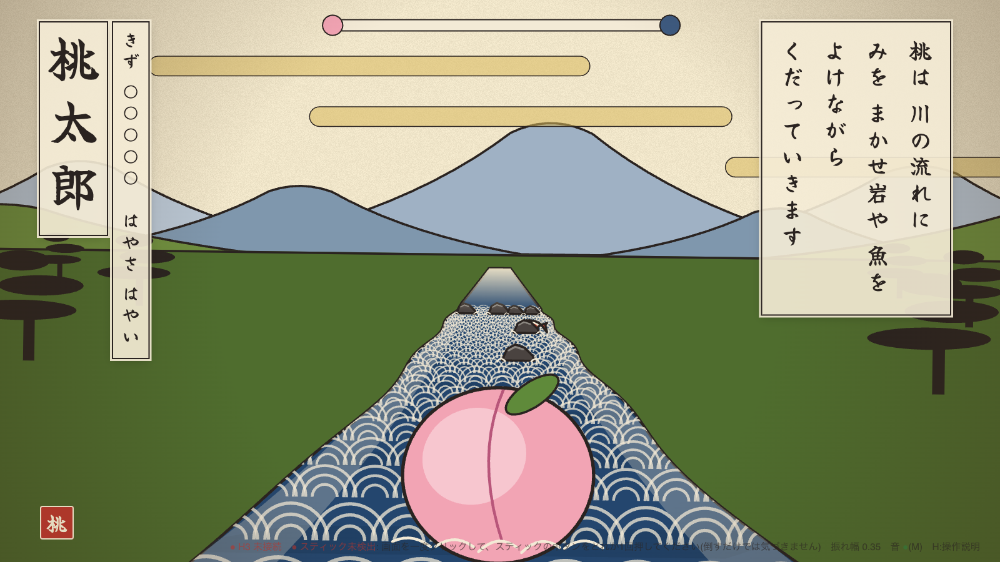

# 桃太郎 beginning




桃になって川を流れるゲーム。
椅子が動く装置「DOF Reality H3」に乗って遊ぶ。
2026年9月のハッカソンで作成。

- ← → (A/D、ゲームパッド、フライトスティック) で舵をとる
- 岩に5回当たる/川の外に出る/おばあさんの前を速く通り過ぎると失敗
- 岸に寄ってゆっくりになり、白い布のそばを通ると、おばあさんに拾われてクリア
- 琴とせせらぎの音はブラウザの中で作っている(音のファイルなし)

## 動かし方

```
pip install pyserial pygame
python3 bridge.py
```

H3 がつながっていなくても、画面だけで遊べる。
スティック等の確認: http://localhost:8891/devices
- ゲーム: http://localhost:8891/

## 中身

- `web/index.html` … ゲーム本体
- `bridge.py` … 画面と H3 の橋渡しをするサーバー
- `h3_direct.py` … H3 を USB で直接動かす
- `h3_srs.py` … Sim Racing Studio 経由で動かす
- `joy_reader.py` … スティック・ペダルを読む
